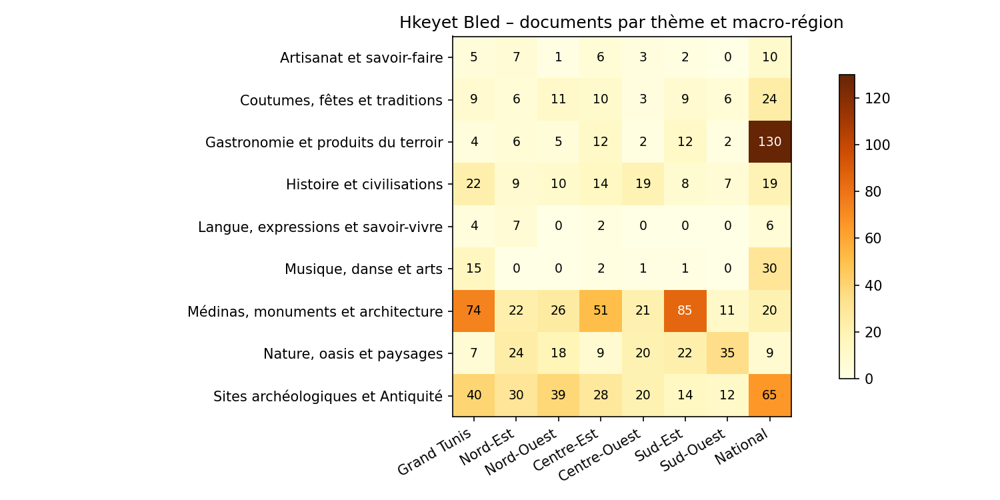

# Fiche de corpus — Hkeyet Bled RAG

*Lot 1 · Corpus et collecte — généré automatiquement le 2026-11-10 par `run_pipeline.py report`*

## 1. Identité du corpus

| Élément | Valeur |
|---|---|
| Nom | Hkeyet Bled – corpus patrimoine et traditions tunisiennes |
| Objectif | Base documentaire d'un assistant RAG répondant aux questions sur le patrimoine, l'artisanat, la gastronomie et les coutumes tunisiennes, et proposant récits et itinéraires culturels |
| Public visé | Touristes, étudiants, guides |
| Langues | ar (229), en (243), fr (691) |
| Documents | **1163** |
| Volume | 1,137,601 mots ≈ 1,535,747 tokens |
| Fichier principal | `data/corpus.jsonl` (1 document par ligne, UTF-8) |
| Version partageable | `data/corpus_public.jsonl` (texte retiré pour les sources non redistribuables, lien conservé) |

## 2. Sources et licences

| source | type | licence | redistribuable | documents | mots |
|---|---|---|---|---|---|
| wikipedia | encyclopedie | CC BY-SA 4.0 | oui | 1089 | 1037655 |
| wikivoyage | guide_voyage | CC BY-SA 4.0 | oui | 46 | 67731 |
| blogs | blog | © auteurs respectifs – usage pédagogique avec citation | non (liens seulement) | 13 | 6993 |
| unesco_whc | officiel | © UNESCO – réutilisation non commerciale avec citation (vérifier les conditions) | non (liens seulement) | 9 | 9545 |
| ontt | officiel | © ONTT – tous droits réservés (usage pédagogique avec citation) | non (liens seulement) | 4 | 13170 |
| inp | officiel | © INP – tous droits réservés (usage pédagogique avec citation) | non (liens seulement) | 2 | 2507 |

Règles appliquées : API officielle MediaWiki pour Wikipédia/Wikivoyage (User-Agent identifié, 1 requête/s), `robots.txt` vérifié avant chaque page web, aucune page derrière authentification, citation systématique de l'URL d'origine dans chaque document. Les textes Wikipédia/Wikivoyage (CC BY-SA 4.0) sont redistribuables avec attribution ; les pages UNESCO, INP, ONTT et blogs ne sont utilisées que pour l'index local à des fins pédagogiques et ne sont partagées que sous forme de liens.

## 3. Couverture par thème

| code | libellé | documents | mots | fr | ar | en | statut |
|---|---|---|---|---|---|---|---|
| architecture_medinas | Médinas, monuments et architecture | 310 | 279463 | 225 | 34 | 51 | OK |
| patrimoine_archeologique | Sites archéologiques et Antiquité | 248 | 251591 | 113 | 57 | 78 | OK |
| gastronomie | Gastronomie et produits du terroir | 173 | 103957 | 77 | 54 | 42 | OK |
| nature_paysages | Nature, oasis et paysages | 144 | 126656 | 107 | 18 | 19 | OK |
| histoire | Histoire et civilisations | 108 | 186874 | 64 | 25 | 19 | OK |
| coutumes_fetes | Coutumes, fêtes et traditions | 78 | 78962 | 54 | 9 | 15 | OK |
| musique_arts | Musique, danse et arts | 49 | 40076 | 17 | 24 | 8 | OK |
| artisanat | Artisanat et savoir-faire | 34 | 19969 | 24 | 5 | 5 | OK |
| langue_savoir_vivre | Langue, expressions et savoir-vivre | 19 | 50053 | 10 | 3 | 6 | OK |

Seuil de couverture : 15 documents par thème. Tous les thèmes atteignent le seuil.

## 4. Couverture géographique (24 gouvernorats)

| gouvernorat | arabe | macro-région | docs (principal) | docs (cité) | statut |
|---|---|---|---|---|---|
| Tunis | تونس العاصمة | Grand Tunis | 143 | 257 | OK |
| Ariana | أريانة | Grand Tunis | 8 | 18 | OK |
| Ben Arous | بن عروس | Grand Tunis | 16 | 28 | OK |
| Manouba | منوبة | Grand Tunis | 13 | 22 | OK |
| Nabeul | نابل | Nord-Est | 49 | 71 | OK |
| Zaghouan | زغوان | Nord-Est | 25 | 35 | OK |
| Bizerte | بنزرت | Nord-Est | 37 | 58 | OK |
| Beja | باجة | Nord-Ouest | 40 | 56 | OK |
| Jendouba | جندوبة | Nord-Ouest | 35 | 45 | OK |
| Le Kef | الكاف | Nord-Ouest | 13 | 22 | OK |
| Siliana | سليانة | Nord-Ouest | 22 | 32 | OK |
| Sousse | سوسة | Centre-Est | 35 | 51 | OK |
| Monastir | المنستير | Centre-Est | 34 | 44 | OK |
| Mahdia | المهدية | Centre-Est | 30 | 41 | OK |
| Sfax | صفاقس | Centre-Est | 35 | 58 | OK |
| Kairouan | القيروان | Centre-Ouest | 51 | 75 | OK |
| Kasserine | القصرين | Centre-Ouest | 26 | 31 | OK |
| Sidi Bouzid | سيدي بوزيد | Centre-Ouest | 12 | 17 | OK |
| Gabes | قابس | Sud-Est | 30 | 40 | OK |
| Medenine | مدنين | Sud-Est | 54 | 77 | OK |
| Tataouine | تطاوين | Sud-Est | 69 | 75 | OK |
| Gafsa | قفصة | Sud-Ouest | 21 | 31 | OK |
| Tozeur | توزر | Sud-Ouest | 27 | 38 | OK |
| Kebili | قبلي | Sud-Ouest | 25 | 30 | OK |
| National | وطني | National | 313 | - | - |

*docs (principal)* = documents dont c'est la région principale ; *docs (cité)* = documents qui citent significativement le gouvernorat.
Tous les gouvernorats sont couverts.

### 4 bis. Artisanat, gastronomie et coutumes par gouvernorat

Nombre de documents citant le gouvernorat pour chaque thème (un document peut compter pour plusieurs gouvernorats et jusqu'à 3 thèmes). Seuil : 2 documents par gouvernorat pour l'artisanat, la gastronomie et les coutumes. Cases sous le seuil : **15 / 72**.

| gouvernorat | artisanat | gastronomie | coutumes_fetes | patrimoine_archeologique | architecture_medinas | musique_arts | nature_paysages | histoire | langue_savoir_vivre | à renforcer |
|---|---|---|---|---|---|---|---|---|---|---|
| Tunis | 15 | 8 | 27 | 97 | 94 | 28 | 26 | 78 | 8 | - |
| Ariana | 0 | 1 | 4 | 1 | 12 | 0 | 2 | 11 | 0 | Artisanat et savoir-faire, Gastronomie et produits du terroir |
| Ben Arous | 0 | 4 | 2 | 6 | 14 | 2 | 6 | 8 | 5 | Artisanat et savoir-faire |
| Manouba | 4 | 1 | 5 | 3 | 15 | 0 | 0 | 9 | 0 | Gastronomie et produits du terroir |
| Nabeul | 13 | 6 | 13 | 24 | 19 | 2 | 14 | 14 | 13 | - |
| Zaghouan | 0 | 4 | 1 | 18 | 7 | 0 | 10 | 8 | 2 | Artisanat et savoir-faire, Coutumes, fêtes et traditions |
| Bizerte | 7 | 2 | 2 | 8 | 15 | 1 | 23 | 20 | 2 | - |
| Beja | 0 | 8 | 9 | 25 | 16 | 1 | 5 | 16 | 2 | Artisanat et savoir-faire |
| Jendouba | 2 | 3 | 7 | 16 | 13 | 0 | 11 | 14 | 0 | - |
| Le Kef | 1 | 4 | 5 | 11 | 7 | 0 | 3 | 8 | 0 | Artisanat et savoir-faire |
| Siliana | 3 | 2 | 2 | 19 | 3 | 1 | 8 | 4 | 1 | - |
| Sousse | 3 | 6 | 8 | 20 | 25 | 4 | 4 | 16 | 2 | - |
| Monastir | 7 | 5 | 3 | 13 | 27 | 1 | 10 | 14 | 0 | - |
| Mahdia | 4 | 6 | 3 | 18 | 12 | 1 | 3 | 14 | 0 | - |
| Sfax | 4 | 18 | 12 | 12 | 14 | 4 | 6 | 16 | 3 | - |
| Kairouan | 8 | 5 | 7 | 10 | 30 | 8 | 11 | 37 | 0 | - |
| Kasserine | 1 | 0 | 3 | 18 | 5 | 0 | 8 | 6 | 0 | Artisanat et savoir-faire, Gastronomie et produits du terroir |
| Sidi Bouzid | 2 | 2 | 4 | 3 | 1 | 2 | 10 | 3 | 0 | - |
| Gabes | 2 | 9 | 5 | 12 | 10 | 0 | 23 | 15 | 1 | - |
| Medenine | 4 | 14 | 19 | 15 | 28 | 5 | 19 | 15 | 0 | - |
| Tataouine | 0 | 2 | 2 | 5 | 66 | 0 | 7 | 4 | 1 | Artisanat et savoir-faire |
| Gafsa | 1 | 0 | 2 | 9 | 11 | 0 | 14 | 14 | 1 | Artisanat et savoir-faire, Gastronomie et produits du terroir |
| Tozeur | 0 | 6 | 8 | 1 | 7 | 1 | 23 | 5 | 1 | Artisanat et savoir-faire |
| Kebili | 0 | 4 | 5 | 7 | 6 | 0 | 18 | 3 | 0 | Artisanat et savoir-faire |

## 5. Matrice thème × macro-région

| thème | Grand Tunis | Nord-Est | Nord-Ouest | Centre-Est | Centre-Ouest | Sud-Est | Sud-Ouest | National |
|---|---|---|---|---|---|---|---|---|
| Artisanat et savoir-faire | 5 | 7 | 1 | 6 | 3 | 2 | 0 | 10 |
| Coutumes, fêtes et traditions | 9 | 6 | 11 | 10 | 3 | 9 | 6 | 24 |
| Gastronomie et produits du terroir | 4 | 6 | 5 | 12 | 2 | 12 | 2 | 130 |
| Histoire et civilisations | 22 | 9 | 10 | 14 | 19 | 8 | 7 | 19 |
| Langue, expressions et savoir-vivre | 4 | 7 | 0 | 2 | 0 | 0 | 0 | 6 |
| Musique, danse et arts | 15 | 0 | 0 | 2 | 1 | 1 | 0 | 30 |
| Médinas, monuments et architecture | 74 | 22 | 26 | 51 | 21 | 85 | 11 | 20 |
| Nature, oasis et paysages | 7 | 24 | 18 | 9 | 20 | 22 | 35 | 9 |
| Sites archéologiques et Antiquité | 40 | 30 | 39 | 28 | 20 | 14 | 12 | 65 |



## 6. Longueur des documents

| Statistique | Mots |
|---|---|
| min | 64 |
| médiane | 351 |
| moyenne | 978 |
| 90e centile | 1973 |
| max | 39124 |

Estimation pour le Lot 2 : ≈ **4071 chunks** de 400 tokens (sans chevauchement).

## 7. Chaîne de traitement

1. **Collecte** – Wikipédia FR (pivot, 180 articles amorces + catégories), versions AR/EN via les liens interlangues ; Wikivoyage FR/EN ; UNESCO, INP, ONTT (PDF), blogs.
2. **Nettoyage HTML** – suppression infobox, tableaux, bandeaux, navbox, légendes, appels de notes `[1]`, sections « Références / Liens externes / مراجع / وصلات خارجية » ; extraction du contenu principal des pages web (trafilatura / BeautifulSoup).
3. **Encodage** – réparation du mojibake (ftfy), normalisation Unicode NFKC (formes de présentation arabes → lettres standard), suppression des caractères invisibles (ZWJ, marques bidi, BOM), du tatweel et des harakat.
4. **Filtrage** – documents < 80 mots (60 en arabe) écartés ; lignes répétées sur ≥ 3 pages d'un même site (menus, pieds de page) supprimées (341 lignes).
5. **Déduplication** – doublons exacts (hash), quasi-doublons MinHash/LSH (Jaccard ≥ 0.8, même langue) et copies partielles (≥ 80 % du contenu déjà présent ailleurs), paragraphes longs répétés entre documents. Les traductions d'un même article sont conservées et reliées par `group_id`.
6. **Annotation** – région (gazetteer de 24 gouvernorats, FR/AR) et thème (lexique FR/EN/AR) ; corrections manuelles via `config/overrides.csv`.

Documents écartés (572) : trop court : 444, hors sujet : 125, doublon copie partielle : 2, exclu manuellement : 1 — détail dans `data/rejected.jsonl`.

## 8. Schéma d'un document (contrat avec le Lot 2)

| champ | type | description |
|---|---|---|
| id | str | Identifiant unique : source_langue_slug_hash |
| title | str | Titre de la page / de l'article |
| lang | str | Langue : fr, ar, en |
| text | str | Texte nettoyé ; les titres de section commencent par `## `, les items de liste par `- ` |
| url | str | URL d'origine (à afficher comme source citée) |
| source | str | wikipedia, wikivoyage, unesco_whc, inp, ontt, blogs, equipe |
| source_type | str | encyclopedie, guide_voyage, officiel, blog, equipe |
| license | str | Licence / conditions d'utilisation |
| redistributable | bool | Le texte peut-il être partagé publiquement ? |
| region | str | Gouvernorat principal (24 valeurs) ou `National` |
| region_ar | str | Nom arabe du gouvernorat |
| region_macro | str | Grand Tunis, Nord-Est, Nord-Ouest, Centre-Est, Centre-Ouest, Sud-Est, Sud-Ouest, National |
| regions | list[str] | Tous les gouvernorats significativement cités |
| theme | str | Thème principal |
| themes | list[str] | 1 à 3 thèmes |
| group_id | str | Identique pour les versions FR/AR/EN d'un même article |
| categories | list[str] | Catégories Wikipédia (si disponibles) |
| n_words / n_chars | int | Longueur du texte |
| revid | int | Révision Wikipédia figée (reproductibilité) |
| retrieved_at | str | Date/heure de collecte (UTC) |
| annotation | str | `auto` ou `manuelle` (corrigée via config/overrides.csv) |

Exemple (texte tronqué) :

```json
{
  "id": "wikipedia_fr_gouvernorat-de-l-ariana_8dc77f",
  "title": "Gouvernorat de l'Ariana",
  "lang": "fr",
  "text": "Le gouvernorat de l'Ariana (arabe: ولاية أريانة), créé en mars 1983, est l'un des 24 gouvernorats de la Tunisie. Il est situé dans le nord du pays et abrite en 2024 une population estimée à 668 552 habitants. Il a une superficie de 482 km, soit 0,3 % de la superficie du pays. Son chef-lieu est l'Ariana.\nEn septembre 2000, la délégation de La Manouba (partie occidentale du gouvernorat) est élevée a…",
  "url": "https://fr.wikipedia.org/wiki/Gouvernorat_de_l%27Ariana",
  "source": "wikipedia",
  "source_type": "encyclopedie",
  "license": "CC BY-SA 4.0",
  "redistributable": true,
  "region": "Ariana",
  "region_ar": "أريانة",
  "region_macro": "Grand Tunis",
  "regions": [
    "Ariana"
  ],
  "theme": "architecture_medinas",
  "themes": [
    "architecture_medinas",
    "histoire"
  ],
  "group_id": "g_22a857b36b",
  "categories": [
    "Gouvernorat de l'Ariana"
  ],
  "n_words": 505,
  "n_chars": 3206,
  "revid": 240342320,
  "retrieved_at": "2026-11-10T19:13:16+00:00",
  "annotation": "auto"
}
```

## 9. Validation de l'annotation

Un échantillon stratifié de 45 documents est exporté dans `docs/echantillon_validation.csv`. Remplir les colonnes `region_correcte` / `theme_correct` (oui/non), puis reporter ici :

| Mesure | Valeur |
|---|---|
| Précision région (échantillon) | … % |
| Précision thème (échantillon) | … % |

Les erreurs relevées sont corrigées dans `config/overrides.csv` puis `python run_pipeline.py process report`.

## 10. Limites et biais connus

- Sur-représentation de Wikipédia et des grandes villes touristiques (Tunis, Sousse, Djerba, Kairouan) ; patrimoine immatériel rural moins documenté en ligne.
- Annotation automatique par mots-clés : un document « national » peut citer beaucoup de villes ; un article historique sur la « Régence de Tunis » est rattaché à Tunis.
- Le dialecte tunisien (darija) est peu documenté en ligne : il est couvert surtout par les fiches rédigées et vérifiées par l'équipe (`config/manual/`), les autres sources étant en arabe standard, français et anglais.
- Les pages web institutionnelles évoluent : les URL et la date de collecte sont conservées pour la traçabilité ; les révisions Wikipédia (`revid`) figent la version utilisée.
